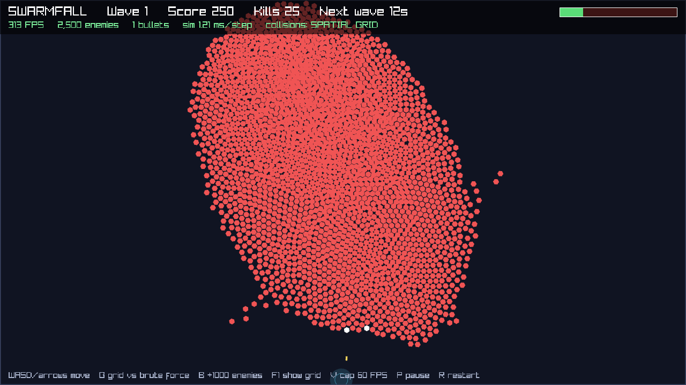
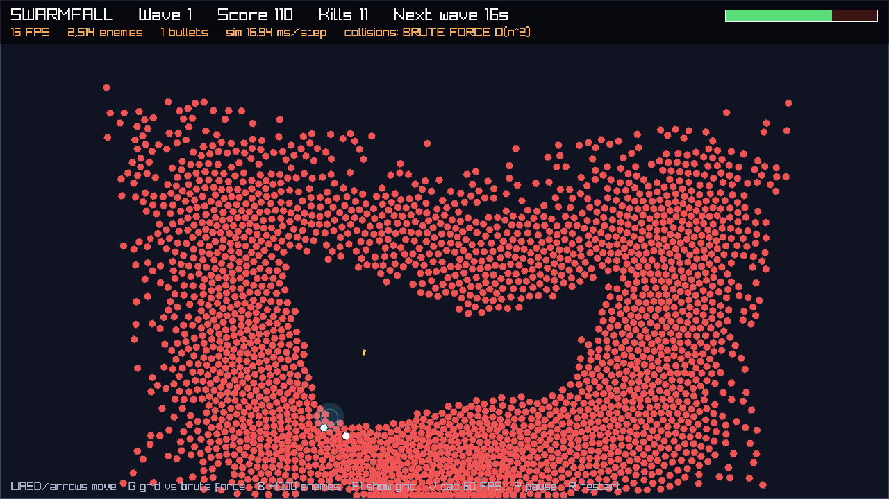
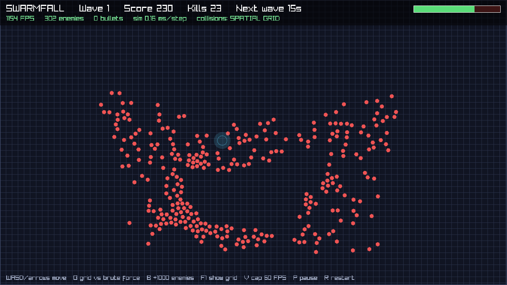

# Swarmfall

A top-down survival shooter in C#. Waves of enemies swarm the player, the ship fires on its own at whatever is closest, and you survive by moving. The waves keep growing until the screen holds thousands of enemies at once.

The game is small on purpose. The point is what happens when there are 8,000 enemies on screen, every one of them pushing off its neighbours: deciding who is near whom is the whole cost of the game, and doing it the obvious way does not survive a big wave.



## The numbers

Each simulation step has to finish in **8.33 ms** to hold 120 steps a second. Headless benchmark, same seeded fight each time, Release build, .NET 10, 8-core laptop:

| Enemies | Spatial grid, mean | Grid p99 | Brute force, mean | Speed-up |
|--------:|-------------------:|---------:|------------------:|---------:|
| 1,000 | 0.27 ms | 0.42 ms | 9.7 ms | 36× |
| 2,000 | 0.68 ms | 1.24 ms | 36.9 ms | 54× |
| 4,000 | 1.69 ms | 2.61 ms | 142.5 ms | 84× |
| 8,000 | 4.59 ms | 6.34 ms | 570.7 ms | 124× |

- **8,000 enemies stay inside the 8.33 ms budget even at p99.** Brute force misses the budget at about 1,000.
- **0 bytes allocated per step** at every size, so the garbage collector never pauses a frame. A test fails the build if that changes.
- In the game, at 2,500 enemies: **248 FPS** with the grid and **15 FPS** with brute force. Press `G` to switch between them while playing and watch the FPS counter.

Full output in [docs/benchmark.md](docs/benchmark.md). Run it yourself with `dotnet run -c Release --project bench/Swarmfall.Bench`.

| Brute force, 2,500 enemies: 15 FPS | Grid overlay (`F1`) |
|---|---|
|  |  |

## Play it

Needs the [.NET 10 SDK](https://dotnet.microsoft.com/download). Windows, macOS or Linux.

```bash
dotnet run -c Release --project src/Swarmfall
```

| Key | Does |
|---|---|
| `WASD` / arrows | Move |
| `G` | Switch collision detection between spatial grid and brute force |
| `B` | Spawn 1,000 more enemies |
| `F1` | Show the grid the simulation uses |
| `V` | Cap at 60 FPS / uncap |
| `P` / `R` / `Esc` | Pause / restart / quit |

## How it works

**The game loop runs on a fixed timestep.** The simulation always advances by exactly 1/120 s, however fast the screen draws, so the game plays the same at 30 FPS and at 300 FPS and the same seed always gives the same game. Rendering draws between the last two steps (interpolation), so motion stays smooth when frame rate and step rate disagree. If a frame is so slow that catching up would need more than four steps, the extra time is dropped and the game slows down instead of locking up (the "spiral of death"). See [`FixedStepClock`](src/Swarmfall.Core/FixedStepClock.cs).

**Neighbours come from a uniform spatial grid.** Every enemy needs its close neighbours twice a step, once to steer away from them and once to stop overlapping them, and every bullet needs the enemy it hits. Checking all pairs is O(n²): 16 million distance checks a step at 4,000 enemies. The grid buckets enemies into cells as wide as the largest query, so a query only reads the 3×3 block of cells around a point. It is rebuilt every step with a counting sort into flat arrays (count per cell, prefix sum, scatter), which is O(n), allocates nothing, and keeps each cell's enemies next to each other in memory. Auto-aim uses the same grid to find the nearest enemy, searching outward ring by ring and stopping as soon as no further ring can hold anything closer. See [`SpatialGrid`](src/Swarmfall.Core/SpatialGrid.cs).

**Nothing is allocated during play.** Enemies and bullets live in fixed-size pools created at startup. Spawning and despawning are O(1); the live entities are kept in a dense list so the update loop never walks over dead slots. Positions sit in their own array apart from the rest of an enemy's state, so the grid reads one tight array. The HUD text is rebuilt four times a second rather than every frame. See [`Pool`](src/Swarmfall.Core/Pool.cs).

**Swarm movement is three rules.** Each enemy steers toward the player at its own speed, pushes away from neighbours harder the closer they are, and any two that still overlap are moved apart by half the overlap each. Without that last rule a large wave collapses into one solid blob. The ship leads its target, aiming where the enemy will be when the bullet arrives.

**The vector maths is written out**, not taken from a library: dot and cross products, normalising without dividing by zero, rotation by the 2D rotation matrix, clamping a vector's length, linear interpolation. See [`Vec2`](src/Swarmfall.Core/Vec2.cs).

## Layout

```
src/Swarmfall.Core/   the whole simulation, no graphics: World, SpatialGrid, Pool, FixedStepClock, Vec2
src/Swarmfall/        the game: raylib window, input, drawing, HUD
bench/                headless benchmark, grid against brute force
tests/                xUnit tests
```

The core never references the graphics library. The game, the benchmark and the tests all drive the same `World` the same way: set the input, call `Step`.

## Tests

```bash
dotnet test
```

26 tests, including:

- The grid finds exactly what brute force finds: 200 random layouts for radius queries and 300 for nearest-enemy, compared result by result.
- `Step` allocates 0 bytes with 3,000 enemies on screen.
- The same seed produces the same game, checked by hashing the full state after 2,000 steps.
- The object pool stays exact through 10,000 random spawns and despawns.
- The fixed-step clock turns uneven frame times into exactly the right number of steps, and recovers after a huge frame.

## Built with

C# and .NET 10, [raylib](https://www.raylib.com/) through [Raylib-cs](https://github.com/ChrisDill/Raylib-cs) for the window and drawing, xUnit for tests. Developed with Claude Code as an agentic coding harness: I set the plan and the performance targets, and reviewed the code, tests and benchmark results.

## What I would do next

- **Draw with instancing.** Once the simulation is this cheap, drawing is a large share of each frame: every enemy's hexagon is built on the CPU and handed to raylib's batcher one at a time. One instanced draw for the whole swarm would move that work to the GPU.
- **Run steering in parallel.** Steering reads neighbours and writes only the enemy itself, so it can be split across cores once the update reads last step's positions instead of positions updated in place.
- **Touch controls**, so it plays on a phone.

## Licence

MIT.
